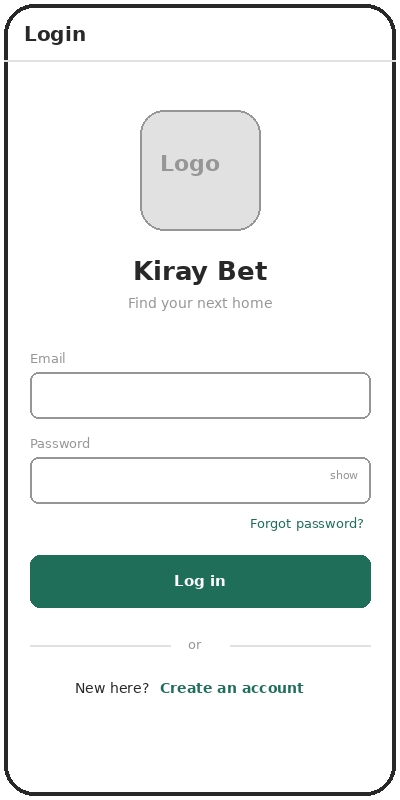
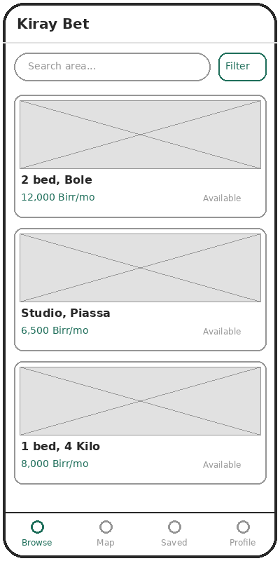
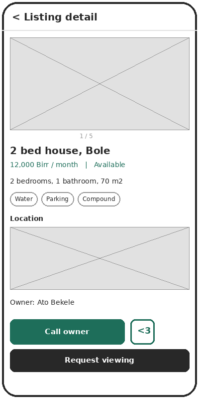
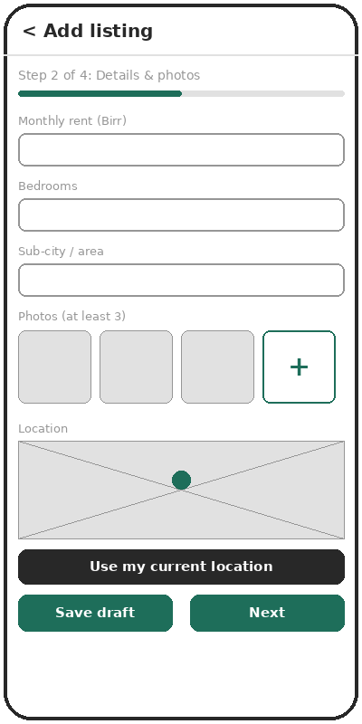

## 1. Title and one-sentence description

**Kiray Bet (ኪራይ ቤት):** An app that helps students, young workers and other house-hunters in Addis Ababa find and compare rental houses in their preferred areas, reducing the time and difficulty of finding suitable accommodation.

## 2. Group

| Name | Role |
|---|---|
| Lelisa Tesfaye | Team lead, project planning, Flutter architecture, Firebase Authentication and integration |
| Miruts Gebremeskel| Backend development, REST API, Firestore and data models |
| Natnael Girmay  | UI/UX design, screen development, navigation and Amharic/English localization |  
| Molalign Michael | Local database (Drift), offline functionality, data synchronization and testing |
| Lammi Abraham | Testing, GPS and camera integration, AI feature and release preparation |

## 3. The problem

Finding a rental house in Addis Ababa is slow, uncertain and expensive. A person looking for a house today usually walks through a neighbourhood looking for "Kiray bet" signs on gates, asks friends and relatives, scrolls through Telegram channels and Facebook groups, or pays a broker (delala). Each method has weaknesses. Signs only cover the streets people happen to visit. Social media posts are often unstructured, outdated or incomplete, making it difficult to compare prices, locations, number of rooms and other house details. Tenants may also encounter fake listings, overpriced houses or properties that are already rented. As a result, they may spend considerable time and money travelling across the city to visit unsuitable houses.

House owners have a similar problem. A landlord with a vacant house has limited ways to reach potential tenants directly and often depends on brokers or informal social media posts. Owners who live outside Addis Ababa or abroad depend even more on intermediaries to advertise and manage their properties.

A mobile application is an appropriate solution because house searching is location-based, and most people already use smartphones for communication and accessing information. Kiray Bet will allow tenants to browse rental houses, compare prices, view photos and locations on a map, save favourites and contact owners directly. Owners will be able to publish and manage their listings without depending entirely on brokers. The application will also support Amharic and English, display rental prices in Birr and provide offline access to saved listings, making the rental process more convenient and accessible.

**Potential user feedback:** Dawit Bekele recently searched for a rental house in Addis Ababa. They mainly relied on Telegram channels, Facebook groups, recommendations from friends and local brokers. They experienced difficulties comparing rental prices, verifying whether houses were still available and finding properties that matched their requirements. They explained that having an application with updated listings, clear prices, photos, location information and direct owner contact would make finding a rental house easier and more reliable.

## 4. Users

**1. Tenants (house-hunters):** University students, young workers and other people looking for rental houses in Addis Ababa. They need to browse available houses, filter listings by price, area, number of bedrooms and amenities, view house photos and locations, save favourite houses and contact owners directly. They would use the application daily when actively searching for accommodation, usually for two to six weeks.

**2. House owners (landlords):** Individuals who own rental houses and want to find tenants without depending entirely on brokers. They need to publish houses with descriptions, rental prices, photos and locations, update listing availability and respond to interested tenants. They would use the application whenever they have vacant properties or receive inquiries from potential tenants.

**3. Administrators (moderators):** Members responsible for monitoring the platform and maintaining listing quality. They need to review reported listings, identify fake or duplicate advertisements and remove inappropriate content. They would use the application periodically, depending on the number of reported listings.

## 5. User stories

1. As a tenant, I want to browse available houses with photos, prices, locations and bedroom counts so that I can find houses that match my needs. **Priority: Must**

2. As a tenant, I want to filter and sort houses by area, price, number of bedrooms and amenities so that I can narrow down my search. **Priority: Must**

3. As a house owner, I want to register, log in and publish a house listing with its details, photos and location so that I can advertise my vacant house to potential tenants. **Priority: Must**

4. As a tenant, I want to view a house's full details, photos, map location and owner contact information so that I can decide whether to contact the owner. **Priority: Must**

5. As a tenant, I want to save favourite houses and access saved listings offline so that I can compare houses later, even without internet access. **Priority: Must**

6. As a tenant, I want to find houses near my current location or a selected area on the map so that I can find accommodation in a convenient location. **Priority: Should**

7. As a tenant, I want to request a house viewing by selecting a date and time so that I can arrange a visit with the owner. **Priority: Should**

## 6. Screens

| Screen | Purpose | User stories |
| ------ | ------- | ------------ |
| Splash and Language Selection | Displays the application logo and allows users to select Amharic or English. | US-01 to US-07 |
| Login | Allows existing tenants and house owners to log in to their accounts. | US-03 |
| Registration | Allows new tenants and house owners to create accounts. | US-03 |
| Home/Browse | Displays available rental houses with photos, prices, locations and bedroom counts. | US-01 |
| Filter and Sort | Allows tenants to filter and sort houses by area, price, bedrooms and amenities. | US-02 |
| Map | Displays house locations and helps tenants find houses near their current or selected location. | US-06 |
| Listing Details | Displays a house's full details, photos, location, rental price and owner contact information. | US-04 |
| Favourites | Displays saved houses and allows tenants to access cached listings offline. | US-05 |
| Add Listing | Allows house owners to publish rental houses with descriptions, prices, photos and locations. | US-03 |
| Edit Listing | Allows house owners to update their existing house details and availability. | US-03 |
| My Listings | Allows house owners to view and manage their published rental houses. | US-03 |
| Viewing Requests | Allows tenants to request house visits by selecting a date and time. | US-07 |
| Profile and Settings | Allows users to manage their profiles, language preferences and account settings. | US-03 |
| Report Listing | Allows tenants to report suspicious, fake or inappropriate listings. | Supporting functionality |
| Moderation | Allows administrators to review reported listings and remove fake or duplicate advertisements. | Supporting functionality |

### Key Screen Sketches

**1. Login Screen**



**2. Home/Browse Screen**



**3. Listing Details Screen**



**4. Add Listing Screen**



## 7. Data model

The application will use the following main entities:

```text
User: id, name, email, phone, role (tenant, owner, admin), preferredLanguage, createdAt

Listing: id, ownerId, title, description, monthlyRentBirr, depositMonths, bedrooms, bathrooms, areaSqm, subCity, neighbourhood, address, latitude, longitude, amenities, photoUrls, status (available, rented, hidden), createdAt, updatedAt

Favorite: userId, listingId, createdAt

ViewingRequest: id, listingId, tenantId, ownerId, proposedDateTime, message, status (pending, accepted, declined, cancelled), createdAt

Report: id, listingId, reporterId, reason, createdAt, resolved

AreaStat: subCity, neighbourhood, bedrooms, averageRentBirr, sampleCount, updatedAt

## 8. Data sources

**Local Storage:**
- Drift (SQLite) will store cached house listings, saved favourites and unfinished listing drafts for offline access.
- SharedPreferences will store user preferences such as language, theme and last-used search filters.

**REST API:**
- The application will communicate with a backend REST API to retrieve area rental statistics and support listing-related operations.
- The API will provide endpoints for retrieving average rental prices by neighbourhood and number of bedrooms.
- OpenStreetMap services will be used for location and map-related information.

**Firebase:**
- Firebase Authentication will handle user registration and login using email and password.
- Cloud Firestore will store user profiles, house listings, favourites, viewing requests and reports.
- Firebase Storage will store uploaded house photos.
- Firestore security rules will control access based on user roles and permissions.

## 9. Device features and AI features

**Device Features:**

- **GPS Location:** The application will use the device's GPS to identify the tenant's current location and display nearby rental houses on the map. House owners will also be able to use their current location when adding a listing. Users can manually select a location if they deny location permission.
- **Camera and Photo Library:** House owners will be able to take photos of their rental houses using the device camera or select existing photos from their gallery when creating or updating listings. The application will request the necessary permissions before accessing these features.

**AI Features:**

- **AI-Powered House Description Generator:** The application will use AI to generate clear and attractive rental house descriptions based on information entered by house owners, such as location, monthly rent, number of bedrooms, bathrooms and available amenities. Owners can review and edit the generated descriptions before publishing their listings.

## 10. Risks

| Risk | Likelihood | Plan |
|---|---|---|
| Not enough real house listings available during development and testing | High | Use sample listings during development and invite house owners to add real listings before the final demonstration. |
| Fake, outdated or inaccurate house listings | Medium | Allow users to report suspicious listings and provide administrators with moderation tools to review and remove them. |
| Unstable or expensive internet access | High | Use local SQLite storage to cache listings, save favourites and support offline access. |
| Firebase or OpenStreetMap services become unavailable or reach usage limits | Medium | Follow free-tier usage limits, monitor service availability and provide alternative manual location selection where possible. |
| Team members have limited availability due to exams or other coursework | Medium | Divide tasks among members, agree on deadlines and regularly review progress to complete the most important features first. |

## 11. Milestones

| Milestone | Target week | Deliverables |
|---|---|---|
| Milestone 1: UI and Navigation | Week 6 | Complete the main application screens, navigation, basic UI components and sample rental house data. |
| Milestone 2: Core Functionality | Week 10 | Implement Firebase Authentication, Firestore integration, REST API, local SQLite storage, house listing management, searching, filtering and favourites. |
| Final Submission | Week 14 | Complete GPS and camera integration, viewing requests, offline functionality, testing, bug fixes and final application demonstration. |

## 12. AI-use plan

AI tools may be used during development to support coding, debugging, documentation and understanding technical concepts. The team will review, test and understand all AI-generated suggestions before including them in the application.

The team will not rely entirely on AI-generated code. Each member will be responsible for understanding and testing the features they implement. All final implementation decisions and project work will be reviewed by the team.
